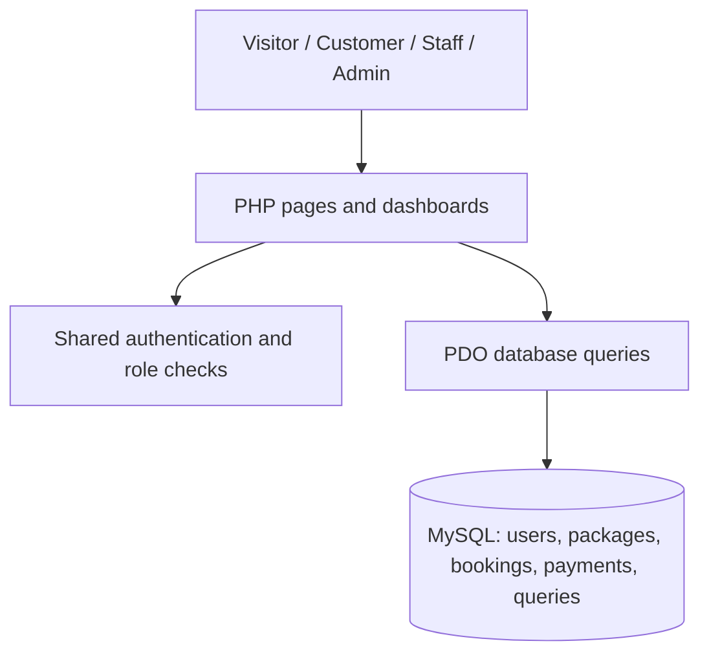

# GlobeTrek Adventures — Academic Project Case Study

**PHP · MySQL · JavaScript · HTML/CSS · Bootstrap**

> **Project context:** Web Application Development coursework at ICBT Campus, Sri Lanka. This is an **academic demonstration**, not a live travel agency, commercial booking service, or production-ready payment platform.

**[View the original academic project's source repository](https://github.com/kevin-menuja/globetrek-adventures)** (now owned by the personal GitHub account; original Git history preserved)

## The problem

A travel-booking application needs to bring destinations, tour packages, traveler accounts, booking requests, and internal administrative work into one connected workflow. GlobeTrek Adventures implements these use cases for a coursework scenario focused on Sri Lankan travel.

## What the application contains

| Area | Implemented in the repository |
| --- | --- |
| **Travel discovery** | Tour packages with keyword, destination, price, and duration filters; paginated results |
| **Trip information** | Package details, itineraries, accommodation, transportation, and travel-guide pages |
| **User accounts** | Registration, sign-in, session-based authentication, and role-separated access |
| **Customer area** | Booking requests, booking history, and contact queries |
| **Staff area** | Booking status management, package updates, and responses to customer queries |
| **Administration** | Staff and package management, booking lists, and dashboard summaries |
| **Data model** | MySQL tables for users, packages, itineraries, bookings, payments, and queries |

These are descriptions of the checked-in source code, not claims that every user journey has been independently tested.

## Technical implementation

The project uses server-rendered PHP pages with a MySQL database accessed through **PDO**. Shared code under `includes/` handles database connections, session state, access checks, form tokens, and output escaping.

A few design and security patterns visible in the source:

- Prepared statements are used in inspected database operations.
- Password registration and sign-in use `password_hash` and `password_verify`.
- Login regenerates the session identifier.
- Role checks protect customer, staff, and administrative routes.
- Form handlers use CSRF tokens; templates frequently use escaped output.

These are implementation observations, **not** a claim that the application passed an independent security audit.

## Original coursework behavior and boundaries

- The payment page is a **simulation**: its card-style form fields validate formats, but the project has no external payment processor. A successful demonstration booking is marked as simulated `paid` in the database. **Never enter real card details.**
- Database setup uses the repository's actual file **`database/schema.sql`**, which creates sample records and drops existing application tables if rerun.
- Some standalone staff/report pages are placeholders, even though related functions exist in the dashboards.
- Hardcoded local paths assume `/globetrek_adventures/`.
- No deployed demo, passing automated integration test suite, real transaction processing, or production readiness is claimed here.

## Portfolio evidence

- **[Browse the application source](https://github.com/kevin-menuja/globetrek-adventures)**
- **[Review the schema](https://github.com/kevin-menuja/globetrek-adventures/blob/main/database/schema.sql)**
- **[Review authentication helpers](https://github.com/kevin-menuja/globetrek-adventures/blob/main/includes/auth.php)**
- **[Review the booking workflow](https://github.com/kevin-menuja/globetrek-adventures/blob/main/booking.php)**

## Attribution and source ownership

The repository was originally hosted under **Startek-pvt-ltd** and has since been transferred to **kevin-menuja**, retaining the original Git history and academic application code. This page documents the original coursework, without claiming additional implementation work or replacing existing contribution history. Specific academic/team contributions should be credited according to the project record.

---

*This case study is portfolio documentation; it does not modify the original academic application's source code or database.*
