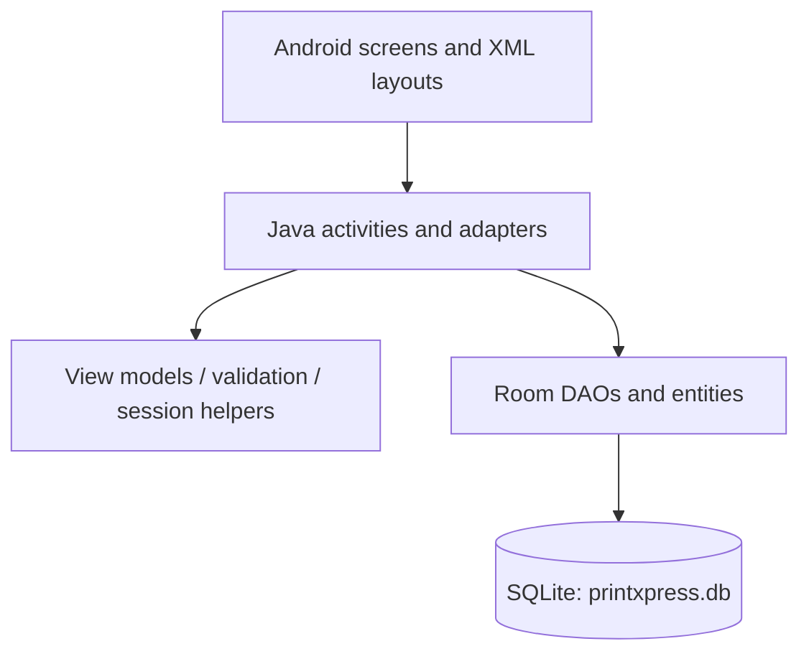

# PrintXpress — Academic Android Application Case Study

**Java 17 · Android SDK 34 · XML / Material Components · Room / SQLite**

> **Academic Android development project** maintained at [kevin-menuja/PrintXpress-Mobile-App](https://github.com/kevin-menuja/PrintXpress-Mobile-App). The implementation uses an on-device data store and demonstration ordering workflow. It is not a deployed commercial print-order or payment service.

## The problem

A custom-printing customer needs to explore available products, choose materials and options, attach artwork, and track an order. PrintXpress demonstrates how these workflows can be organized in a native Android interface using local persistence.

## Application capabilities visible in source

- **Product catalogue:** browsing business cards, flyers, banners, posters, stickers, T-shirts, and mugs
- **Account access:** user registration, sign-in, and session state
- **Order setup:** product and material selection, sizes, quantities, delivery or pickup, requested dates, and instructions
- **Artwork selection:** local file picker and saved design references
- **Order history:** locally stored orders and order-detail screens
- **Other screens:** profile, notifications, gallery, FAQs, guidelines, and promotions

These are source-backed components and do not imply that a complete device-level acceptance test has been run.

## How the application is structured

- **UI:** Java activities, XML layouts, RecyclerView, ViewPager2, Android Material Components
- **Persistence:** Room database with user, product, order, address, promotion, notification, and saved-design entities
- **Database evolution:** version 3, with migration code for versions 1 → 2 → 3
- **Tests:** JUnit tests for validation utilities, including phone format, checksum, expiry, and pricing calculations

## Development challenges and boundaries

- **Local-first architecture:** no backend synchronization service is demonstrated in the source.
- **Academic payment simulation:** the original form performs local card-format validation, not payment processing. Never use actual payment credentials.
- **Setup limitation:** the checked-in repository has Gradle launcher scripts but no `gradle/wrapper/` directory. Builds may require local tooling configuration.
- **Testing evidence:** unit test source exists, but no independently verified passing Android build or device test is claimed.

## Explore the code

- [Complete source](https://github.com/kevin-menuja/PrintXpress-Mobile-App)
- [README and setup](https://github.com/kevin-menuja/PrintXpress-Mobile-App/blob/main/README.md)
- [Room database](https://github.com/kevin-menuja/PrintXpress-Mobile-App/blob/main/app/src/main/java/com/printxpress/app/database/AppDatabase.java)
- [Order screen](https://github.com/kevin-menuja/PrintXpress-Mobile-App/blob/main/app/src/main/java/com/printxpress/app/NewOrderActivity.java)
- [Validation tests](https://github.com/kevin-menuja/PrintXpress-Mobile-App/blob/main/app/src/test/java/com/printxpress/app/utils/ValidationUtilsTest.java)

## Academic attribution

The project is documented in its original repository as an academic Android application. The original README credits **Kevin Menuja Karunarathne** as developer. Ownership is now under **kevin-menuja**, with existing Git history preserved.

---

*This case study is portfolio documentation; the application, database, and demonstration workflows were not changed.*
